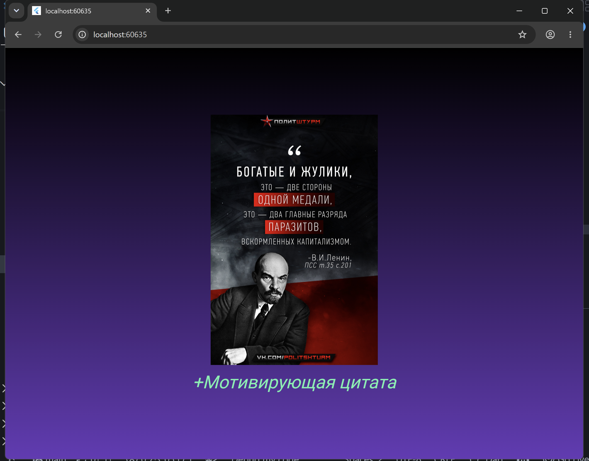

# Лабораторная работа №5. Flutter: самостоятельное приложение
# Приложение "my_app"; Тема: Цитата дня; Описание: Приложение показывает случайную мотивирующую цитату из заранее подготовленного списка.
***
### Приложение создано на основе раннего проекта "flutter_lab4_app". При нажатии на кнопку "+Мотивирующая цитата" с помощью элемента случайности пользователю будут показываться мотивирующие, высокие и просто забавные цитаты.
***
### Приложение создал студент третьего курса группы ИСП-241: Просвиров Дмитрий Анатольевич; Дата сдачи (создания): 09.10.2026
***
**Стек и версии:**
* `Flutter 3.41.8`
* `Dart`
* Платформа: Web (Chrome)
* IDE: VS Code
***
**Скриншот приложения:**

***
**Структура проекта:**

**Описание файлов:**
1. `dice_roller.dart` - виджет, содержащий основные конструкции для создания кнопки рандомного переключения изображений из строго указанного списка.
2. `gradient_container.dart` - виджет, рисующий задний фон для всего экрана, передающий данные через конструктор и центрирующий контент на странице.
3. `main.dart` - основной код программы, содержащий каркас приложения и контрастные цвета фона.
4. `styled_text.dart` - виджет, форматирующий текст кнопки.
***
**Как запустить:**
1. `git clone <ссылка на репозиторий>`
2. `cd <папка проекта>`
3. `flutter pub get`
4. `flutter run -d chrome`
***
**Что изучили:**
1. Самостоятельное создания Flutter-приложения
1. Настройка UI Flutter-приложения
2. Классовый метод создания Flutter-приложения
3. Импорт классов в другие dart-файлы
4. Работа с `pubspec.yaml`
5. Создание кнопок во Flutter-приложении
***
